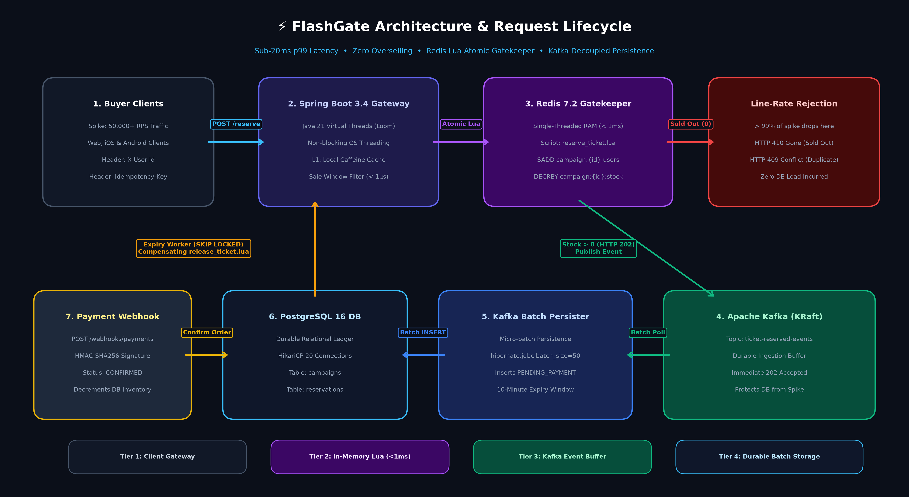
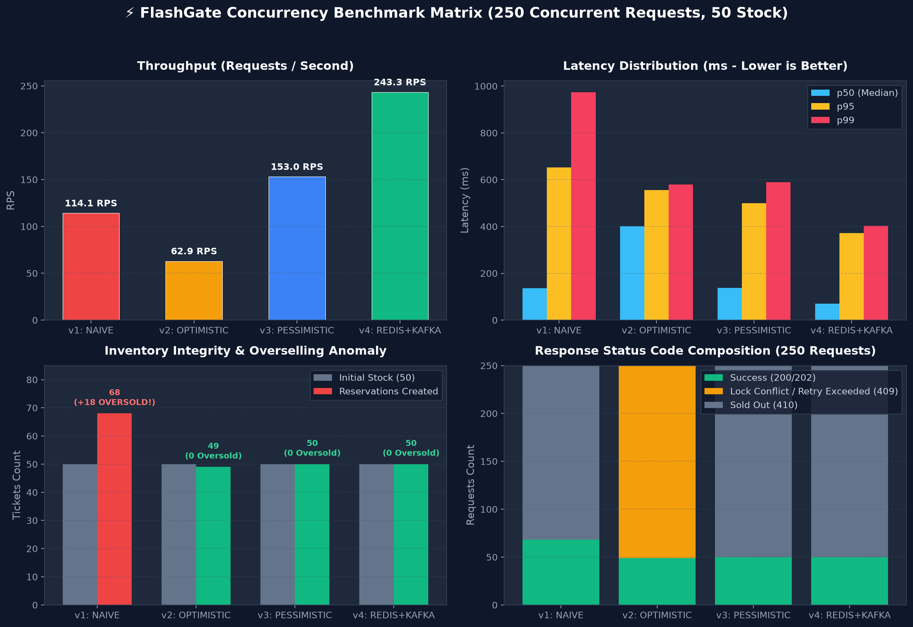

# FlashGate ⚡

> **High-Concurrency Flash Sale & Ticketing Engine**  
> *Built with Java 21 Virtual Threads, Spring Boot 3.4+, Redis 7.2 Lua Scripts, Apache Kafka KRaft, and PostgreSQL 16.*

[](https://github.com/gitApurv/FlashGate/actions/workflows/ci.yml)
[](https://openjdk.org/projects/jdk/21/)
[](https://spring.io/projects/spring-boot)
[](https://www.postgresql.org/)
[](https://redis.io/)
[](https://kafka.apache.org/)
[](LICENSE)

---

## 1. Executive Summary

Standard e-commerce architectures rely on synchronous relational transactions (`SELECT` followed by `UPDATE`) to decrement inventory. During high-demand ticket drops or flash sales, traffic spikes $100\times$ within milliseconds. This saturates the HikariCP connection pool, triggers severe row-level lock contention in PostgreSQL, and causes cascading timeouts, node crashes, or oversold inventory.

**FlashGate** solves this by decoupling **real-time in-memory reservation gatekeeping** from **durable persistence**:
1. **In-Memory Atomic Gatekeeper:** Single-threaded Redis Lua scripts validate buyer eligibility and decrement inventory atomically in $<1\text{ ms}$, rejecting $>99\%$ of excess traffic before it touches PostgreSQL.
2. **Virtual Threads (Project Loom):** Java 21 Virtual Threads handle tens of thousands of concurrent open client sockets without reactive callback complexity.
3. **Asynchronous Write Buffering:** Apache Kafka buffers verified reservations so PostgreSQL writes occur at a smooth, predictable batch rate (`hibernate.jdbc.batch_size=50`).
4. **Self-Healing Recovery & Restock:** Background schedulers poll expired reservations using `SELECT ... FOR UPDATE SKIP LOCKED` (10-minute TTL) and restore stock to Redis via compensating Lua scripts. A `pending_sync` reconciler heals edge-case node crashes.

---

## 2. Architecture & Data Flow



```text
[Buyer Client]
   │  1. POST /api/v1/campaigns/{id}/reserve (Headers: X-User-Id, Idempotency-Key)
   ▼
[Spring Boot 3.4 + Java 21 Virtual Threads]
   │
   ├──► Local Clock Check (Reject with HTTP 403 if outside sale window via Caffeine cache)
   │
   ├──► [Redis 7.2: reserve_ticket.lua] (Atomic check & decrement in < 1ms)
   │       ├── Return -1 (Duplicate User) ──► HTTP 409 Conflict
   │       ├── Return  0 (Stock == 0)     ──► HTTP 410 Gone (99% of spike traffic stops here)
   │       └── Return  1 (Stock Decremented & Stream/Hash Entry Written)
   │
   ├──► [Apache Kafka: topic "ticket-reserved-events"]
   │       └── Returns HTTP 202 Accepted + reservationId to Client immediately
   │
   ▼
[Kafka Batch Consumer Worker]
   ├──► Inserts PENDING_PAYMENT row into PostgreSQL 16 (expires_at = NOW() + 10 mins)
   │
   ▼
[Resolution Path A: Payment Webhook]           [Resolution Path B: Expiry Scheduler (Every 5s)]
   ├── POST /api/v1/webhooks/payments             ├── Polls expired PENDING_PAYMENT rows (SKIP LOCKED)
   └── Marks row CONFIRMED in PostgreSQL          ├── Marks row EXPIRED in PostgreSQL
                                                  └── Runs release_ticket.lua in Redis (+1 stock)
```

---

## 3. Concurrency Control Strategies & Benchmark Matrix

FlashGate implements the **Strategy Pattern**, allowing real-time switching of concurrency mechanisms via the `X-Concurrency-Mode` HTTP request header. Below are the **empirical measurements** captured under identical spike test conditions (250 concurrent requests, 25 parallel worker threads, 50 available stock):

| Strategy Mode | Concurrency Control | Duration | Throughput (RPS) | p50 Latency | p95 Latency | p99 Latency | Oversold Count | Failure Mode & Behavioral Characteristics |
| :--- | :--- | :---: | :---: | :---: | :---: | :---: | :---: | :--- |
| **`v1: NAIVE`** | JPA Read-Modify-Write | 2.19s | 114.1 RPS | 136.1 ms | 652.8 ms | 974.1 ms | **+18 (+36%)** | **Data Corruption:** Lost updates allowed 68 reservations for 50 tickets. |
| **`v2: OPTIMISTIC_LOCK`** | JPA `@Version` + Retries | 3.97s | 62.9 RPS | 400.7 ms | 556.1 ms | 579.7 ms | **0** | **High Abort Rate:** 201/250 requests (80.4%) failed due to retry exhaustion. |
| **`v3: PESSIMISTIC_LOCK`** | DB `SELECT ... FOR UPDATE` | 1.63s | 153.0 RPS | 137.6 ms | 498.9 ms | 590.0 ms | **0** | **Database Queuing:** Serialized row lock holds DB connections in HikariCP. |
| **`v4: REDIS_KAFKA_PIPELINE`** | Redis Lua + Kafka Buffer | **1.03s** | **243.3 RPS** | **71.0 ms** | **371.7 ms** | **402.4 ms** | **0** | **Winner:** 2.1x faster than Naive, 3.9x faster than Optimistic, zero DB spike load. |

> 📊 **Empirical Benchmark Report & Telemetry Visuals:** See [docs/benchmarks/BENCHMARK_REPORT.md](docs/benchmarks/BENCHMARK_REPORT.md) for full telemetry datasets, root-cause analyses, and terminal cards.



---

## 4. Key Architectural Decisions (ADRs)

- [ADR-001: Virtual Threads over Reactive Programming](docs/adr/ADR-001-virtual-threads-vs-reactive.md)
- [ADR-002: In-Memory Redis Lua Gatekeeper & Kafka Write Buffering](docs/adr/ADR-002-redis-lua-gatekeeper-and-kafka-buffering.md)
- [ADR-003: Inventory Partitioning & Slot Bucketing for Hyper-Scale (>100k RPS)](docs/adr/ADR-003-inventory-slot-bucketing.md)
- [ADR-004: Dual-Channel Expiration via PostgreSQL SKIP LOCKED](docs/adr/ADR-004-dual-channel-reconciliation-and-skip-locked-expiry.md)

---

## 5. API Reference

Complete OpenAPI 3.1 specification available at [docs/api/openapi.yaml](docs/api/openapi.yaml).

### Core Endpoints

#### 1. Reserve Ticket
- **Method:** `POST /api/v1/campaigns/{campaignId}/reserve`
- **Headers:**
  - `X-User-Id`: UUID (Required)
  - `Idempotency-Key`: String (Required)
  - `X-Concurrency-Mode`: `NAIVE | OPTIMISTIC_LOCK | PESSIMISTIC_LOCK | REDIS_KAFKA_PIPELINE` (Optional, default `REDIS_KAFKA_PIPELINE`)
- **Responses:**
  - `202 Accepted`: Ticket reserved, queued for persistence.
  - `403 Forbidden`: Flash sale window is closed.
  - `409 Conflict`: User already holds a reservation.
  - `410 Gone`: Campaign is sold out.

#### 2. Check Reservation Status
- **Method:** `GET /api/v1/reservations/{reservationId}`
- **Responses:**
  - `200 OK`: Returns order details and status (`PENDING_PAYMENT`, `CONFIRMED`, `EXPIRED`, `CANCELLED`).

#### 3. Payment Webhook Ingestion
- **Method:** `POST /api/v1/webhooks/payments`
- **Header:** `X-Webhook-Signature`: HMAC-SHA256 signature
- **Body:**
  ```json
  {
    "reservationId": "0192f3a4-8c1e-7000-8000-4a9b1c2d3e4f",
    "paymentId": "pay_987654",
    "eventType": "PAYMENT_SUCCEEDED",
    "amountCents": 9900
  }
  ```

### Postman Collection
A pre-configured Postman suite is included in the [`postman/`](postman/) directory:
- [FlashGate Collection (`postman/FlashGate.postman_collection.json`)](postman/FlashGate.postman_collection.json)
- [FlashGate Environment (`postman/FlashGate.postman_environment.json`)](postman/FlashGate.postman_environment.json)

Import both into Postman to immediately execute and verify all endpoints.

---

## 6. Quickstart & Local Setup

### Prerequisites
- Java 21+ LTS
- Maven 3.9+
- Docker & Docker Compose

### 1. Launch Infrastructure
```bash
docker compose up -d
```
This spins up:
- **PostgreSQL 16** (`localhost:5432`)
- **Redis 7.2** (`localhost:6379`)
- **Apache Kafka KRaft** (`localhost:9092`)
- **Prometheus** (`localhost:9090`)
- **Grafana** (`localhost:3000`, user: `admin`, pass: `admin`)

### 2. Build and Run Application
```bash
mvn clean package -DskipTests
java -jar target/flashgate-1.0.0.jar
```

### 3. Automated 20-Second Live Spike Demo
Run the turnkey end-to-end spike test script with a single command:
```bash
# Windows PowerShell
./scripts/demo.ps1

# Linux / macOS / WSL
./scripts/demo.sh
```

### 4. Run Load Benchmark with k6
```bash
# Test Redis Lua + Kafka Pipeline (Target)
k6 run -e CONCURRENCY_MODE=REDIS_KAFKA_PIPELINE k6/flash_sale_spike.js

# Test Pessimistic Lock Mode
k6 run -e CONCURRENCY_MODE=PESSIMISTIC_LOCK k6/flash_sale_spike.js
```

---

## 7. Verification & Automated Tests

Run the complete test suite:
```bash
mvn test
```

Test coverage includes:
- Context initialization and Virtual Threads configuration.
- Flyway schema constraints and check assertions.
- Concurrency race conditions proving overselling in `v1` vs zero-overselling in `v3` and `v4`.
- Pre-sale Redis stock and Caffeine local cache warmup.
- Redis Lua script execution and idempotency retry verification.
- PostgreSQL `SKIP LOCKED` scheduled expiry and compensating stock restock.
- HMAC-SHA256 payment webhook verification and late payment rejection.
- Micrometer metrics publication for Prometheus and Grafana.
