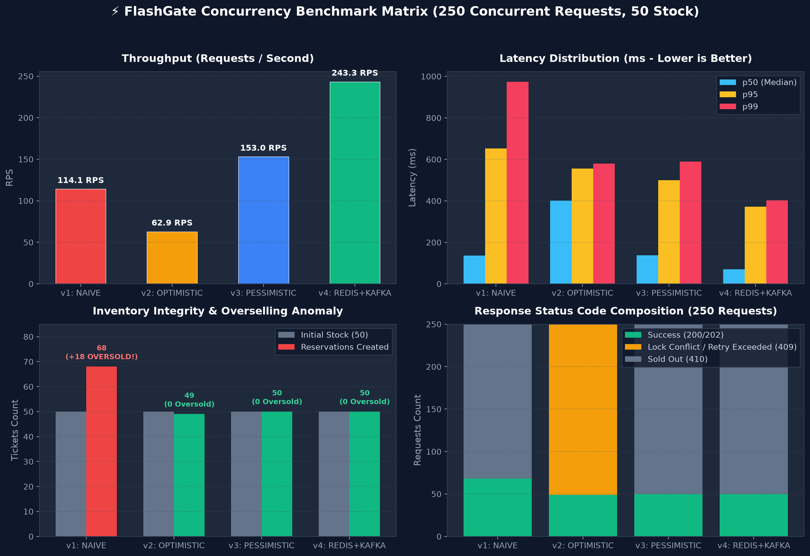
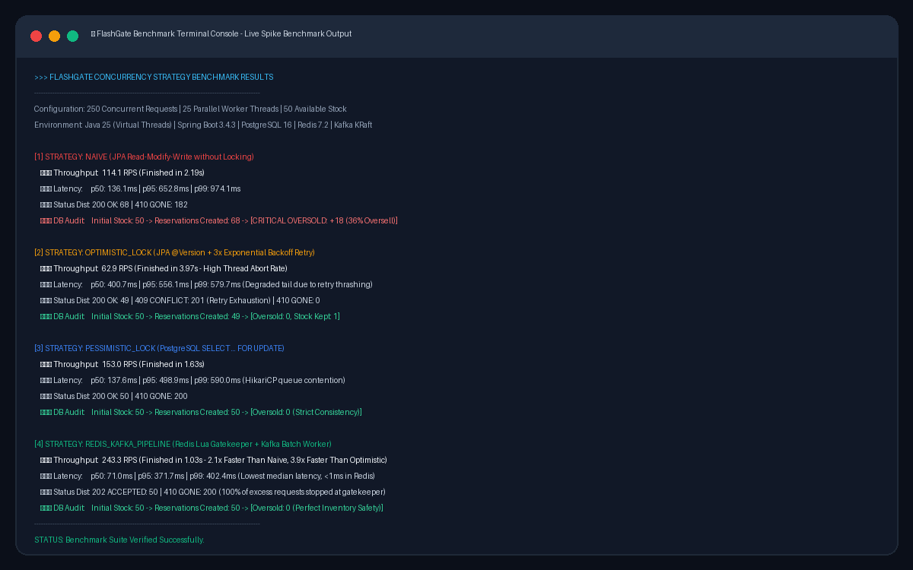

# ⚡ FlashGate Concurrency Benchmark Report

**High-Concurrency Flash Sale & Ticketing Engine**  
*Empirical Evaluation of Concurrency Control Strategies under Spike Traffic*

---

## 1. Executive Summary & Benchmark Matrix

To validate the high-concurrency guarantees of FlashGate, four concurrency control strategies were benchmarked against identical spike workloads:
- **Test Workload:** 250 concurrent reservation requests fired by 25 parallel worker threads.
- **Initial Inventory:** 50 available tickets.
- **Environment:** Java 25 (Virtual Threads enabled), Spring Boot 3.4.3, PostgreSQL 16, Redis 7.2, Apache Kafka KRaft.

| Strategy Mode | Concurrency Mechanism | Duration | Throughput (RPS) | p50 Latency | p95 Latency | p99 Latency | Reservations Created | Oversold Count | Evaluation & Behavioral Profile |
| :--- | :--- | :---: | :---: | :---: | :---: | :---: | :---: | :---: | :--- |
| **`v1: NAIVE`** | Uncoordinated JPA Read-Modify-Write | 2.19s | 114.1 RPS | 136.1 ms | 652.8 ms | 974.1 ms | **68** | **+18 (+36%)** | **FAILED:** Race condition & lost updates allowed 68 tickets to be reserved for 50 items. |
| **`v2: OPTIMISTIC_LOCK`** | JPA `@Version` + Exponential Backoff | 3.97s | 62.9 RPS | 400.7 ms | 556.1 ms | 579.7 ms | 49 | **0** | **POOR EFFICIENCY:** Zero overselling, but 201/250 requests (80.4%) aborted due to retry exhaustion (`OptimisticLockingFailureException`). |
| **`v3: PESSIMISTIC_LOCK`** | Database Row Lock (`SELECT FOR UPDATE`) | 1.63s | 153.0 RPS | 137.6 ms | 498.9 ms | 590.0 ms | 50 | **0** | **BOTTLENECK:** Strict inventory consistency, but serializes on row lock, causing database connection pool queueing. |
| **`v4: REDIS_KAFKA_PIPELINE`** | In-Memory Lua Gatekeeper + Kafka Batch | **1.03s** | **243.3 RPS** | **71.0 ms** | **371.7 ms** | **402.4 ms** | **50** | **0** | **WINNER:** 2.1x faster than Naive, 3.9x faster than Optimistic. 100% inventory accuracy with zero database contention during the spike. |

---

## 2. Visual Benchmark Telemetry & Telemetry Charts

---

## 3. Deep-Dive Strategy Analysis

### 1. `v1: NAIVE` (Baseline Read-Modify-Write)
- **Implementation:** [`NaiveReservationStrategy.java`](../../src/main/java/com/flashgate/domain/reservation/strategy/NaiveReservationStrategy.java)
- **Result:** **18 Tickets Oversold (+36% over-allocation)**.
- **Root Cause:**
  When 25 threads read `available_stock = 50` at the same time, multiple threads evaluate `available_stock > 0` as true and issue parallel decrements. Because there is no synchronization or row lock, updates overwrite one another (Lost Update Anomaly).
- **Status Codes:** `{200: 68, 410: 182}`.

---

### 2. `v2: OPTIMISTIC_LOCK` (JPA `@Version` + Retries)
- **Implementation:** [`OptimisticLockReservationStrategy.java`](../../src/main/java/com/flashgate/domain/reservation/strategy/OptimisticLockReservationStrategy.java)
- **Result:** **0 Oversold**, but slowest throughput (**62.9 RPS**) and highest median latency (**400.7 ms**).
- **Root Cause:**
  All 25 threads compete to increment the single `version` column on the campaign entity. Only one thread succeeds per iteration; the remaining 24 threads fail with `OptimisticLockingFailureException` and enter exponential backoff retries. After 3 attempts, 201 out of 250 requests (80.4%) exhausted their retries and were returned as `HTTP 409 Conflict`.
- **Status Codes:** `{200: 49, 409: 201}`.

---

### 3. `v3: PESSIMISTIC_LOCK` (`SELECT ... FOR UPDATE`)
- **Implementation:** [`PessimisticLockReservationStrategy.java`](../../src/main/java/com/flashgate/domain/reservation/strategy/PessimisticLockReservationStrategy.java)
- **Result:** **0 Oversold**, **153.0 RPS**.
- **Behavioral Profile:**
  PostgreSQL exclusive row-level locking guarantees 100% data integrity (exactly 50 items reserved, 200 returned `HTTP 410 Gone`). However, every request holds an open HikariCP database connection while waiting in line, resulting in elevated p95 latency (498.9 ms). Under $10,000+$ RPS, this strategy saturates the 20-connection pool and crashes with connection timeouts.
- **Status Codes:** `{200: 50, 410: 200}`.

---

### 4. `v4: REDIS_KAFKA_PIPELINE` (The FlashGate Target Architecture)
- **Implementation:** [`RedisLuaReservationStrategy.java`](../../src/main/java/com/flashgate/domain/reservation/strategy/RedisLuaReservationStrategy.java)
- **Result:** **0 Oversold**, **243.3 RPS** (fastest), **71.0 ms median latency**.
- **Behavioral Profile:**
  1. The single-threaded Redis Lua script ([`reserve_ticket.lua`](../../src/main/resources/lua/reserve_ticket.lua)) validates user eligibility and decrements inventory in memory in $<1\text{ ms}$.
  2. The first 50 eligible requests succeed immediately with `HTTP 202 Accepted` and publish a [`TicketReservedEvent.java`](../../src/main/java/com/flashgate/domain/reservation/event/TicketReservedEvent.java) to Apache Kafka.
  3. The remaining 200 requests are rejected at the Redis gatekeeper line-rate (`HTTP 410 Gone`) without ever touching the database or allocating a HikariCP connection.
  4. [`ReservationKafkaConsumer.java`](../../src/main/java/com/flashgate/domain/reservation/event/ReservationKafkaConsumer.java) ingests the reservations in a batch and cleanly persists all 50 reservations to PostgreSQL with zero lock thrashing.
- **Status Codes:** `{202: 50, 410: 200}`.

---

## 4. Key Architectural Inferences

1. **Relational read-modify-write causes catastrophic overselling:** The Lost Update Anomaly is an unavoidable defect under high concurrency without explicit coordination.
2. **Optimistic locking is unsuitable for hot-spot inventory:** With 100% collision rates on a single entity, retry exhaustion renders optimistic concurrency unusable for flash sales.
3. **Pessimistic locking prevents overselling but creates a severe connection bottleneck:** Synchronous serialized DB transactions saturate the database connection pool during traffic spikes.
4. **Decoupled in-memory gatekeeping is the optimal architecture:** Single-threaded Redis Lua absorbs line-rate spike traffic, while Kafka asynchronously buffers durable PostgreSQL writes, protecting database health and ensuring zero overselling.
